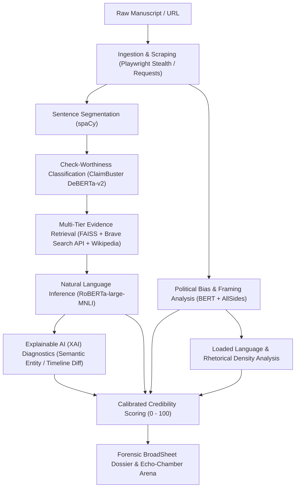

# BeyondBinary System Architecture & Technical Specifications

**BeyondBinary** is an Explainable Artificial Intelligence (XAI) media credibility and political bias analysis platform designed to mitigate polarization and automate forensic claim verification.

---

## 1. Directory Structure

```
BeyondBinary/
├── backend/                     # Python Backend Services & Neural Inference
│   ├── __init__.py              # Package initialization & path resolution
│   ├── main.py                  # FastAPI routers, endpoints, CORS & SPA serving
│   ├── verifier.py              # RoBERTa-large-MNLI premise entailment engine
│   ├── claim_extractor.py       # ClaimBuster DeBERTa-v2 check-worthiness extraction
│   ├── bias_detector.py         # Political Bias BERT + AllSides 101-outlet grounding
│   ├── scorer.py                # Calibrated multi-factor credibility scoring
│   ├── xai_explainer.py         # Explainable AI semantic conflict & rationale engine
│   ├── search_provider.py       # Multi-Tier search hierarchy (Brave API → Wiki → RSS)
│   ├── article_fetcher.py       # Multi-tier web article ingestion & parsing
│   ├── playwright_fetcher.py    # Playwright stealth headless browser crawler
│   ├── news_provider.py         # GNews aggregator fallback
│   └── feed_parser.py           # RSS XML feed parsing
│
├── frontend/                    # Modern React + Vite + Tailwind CSS Application
│   ├── src/
│   │   ├── components/
│   │   │   ├── Analyzer/        # ArticleReader, ClaimsList, CredibilityGauge,
│   │   │   │                    # EchoChamberArena, AnalysisProgressStepper, IngestionBar
│   │   │   ├── Trending/        # TrendingWire, ArticleCard (real-time newsfeed)
│   │   │   └── Navbar.tsx       # Broadsheet editorial masthead navigation
│   │   ├── services/api.ts      # REST API client
│   │   └── types/api.ts         # TypeScript data contracts & XAI interfaces
│   ├── dist/                    # Compiled production assets served by FastAPI
│   └── package.json
│
├── data/                        # Static indices & Knowledge Bases
│   ├── fever_index.faiss        # 384-dimensional FAISS index for semantic retrieval
│   ├── passages.pkl             # Reference knowledge passages
│   ├── allsides_ratings.json    # AllSides Media Intelligence database (101 outlets)
│   └── allowed_publications.json# Whitelisted trusted publications
│
├── scripts/                     # Maintenance & Evaluation Utilities
│   └── build_index.py           # Offline FAISS index builder
│
├── docs/                        # Formal Documentation
│   └── ARCHITECTURE.md          # Technical specifications & mathematical models
│
├── main.py                      # Root entrypoint (forwards to backend.main:app)
├── requirements.txt             # Python dependencies
├── .env.example                 # Environment variables specification
└── README.md                    # Primary setup guide & walkthrough
```

---

## 2. Core Processing Pipeline



---

## 3. Mathematical Models & Formulations

### 3.1 Composite Credibility Score
The credibility score $S \in [0, 100]$ evaluates factual entailment weighted by model confidence and penalizes sensationalist rhetoric:

$$S = 100 \times \left( \frac{\sum_{i=1}^N w_i \cdot \mathbb{I}(v_i)}{\sum_{i=1}^N w_i} \right) - \lambda \cdot D_{\text{loaded}}$$

Where:
- $v_i \in \{\text{Supported}, \text{Refuted}, \text{Not Enough Info}\}$ is the NLI verdict for claim $i$.
- $\mathbb{I}(\text{Supported}) = 1.0$, $\mathbb{I}(\text{Not Enough Info}) = 0.5$, $\mathbb{I}(\text{Refuted}) = 0.0$.
- $w_i = \text{confidence}_i$ from RoBERTa-large-MNLI softmax probability.
- $D_{\text{loaded}}$ is the percentage density of pejorative/sensationalist lexical markers.
- $\lambda = 0.5$ is the framing discount coefficient.

### 3.2 Polarization Index (Cross-Perspective Comparison)
The side-by-side **Echo-Chamber Deck** computes divergence between two articles reporting on the same event using Total Variation Distance (TVD) across stance distributions:

$$\text{TVD}(P_A, P_B) = \frac{1}{2} \sum_{c \in \{\text{Left}, \text{Center}, \text{Right}\}} |P_A(c) - P_B(c)|$$

$$\text{Polarization Index} = \min\left(100, 100 \times \left(0.70 \cdot \text{TVD} + 0.30 \cdot |\text{DomainBias}_A - \text{DomainBias}_B|\right)\right)$$

---

## 4. Explainable AI (XAI) Diagnostics
The `xai_explainer.py` engine performs deterministic token-level conflict detection:
1. **Temporal Consistency**: Compares extracted 4-digit timeline years ($Y_{\text{claim}} \neq Y_{\text{evidence}}$).
2. **Quantitative Scale**: Flags order-of-magnitude discrepancies in cited numbers or percentages.
3. **Polarity Inversion**: Detects negation markers (`denied`, `rejected`, `false`) in the evidence when the claim is affirmative.
4. **Attributive Framing**: Identifies pejorative rhetoric introducing unsubstantiated crisis.
